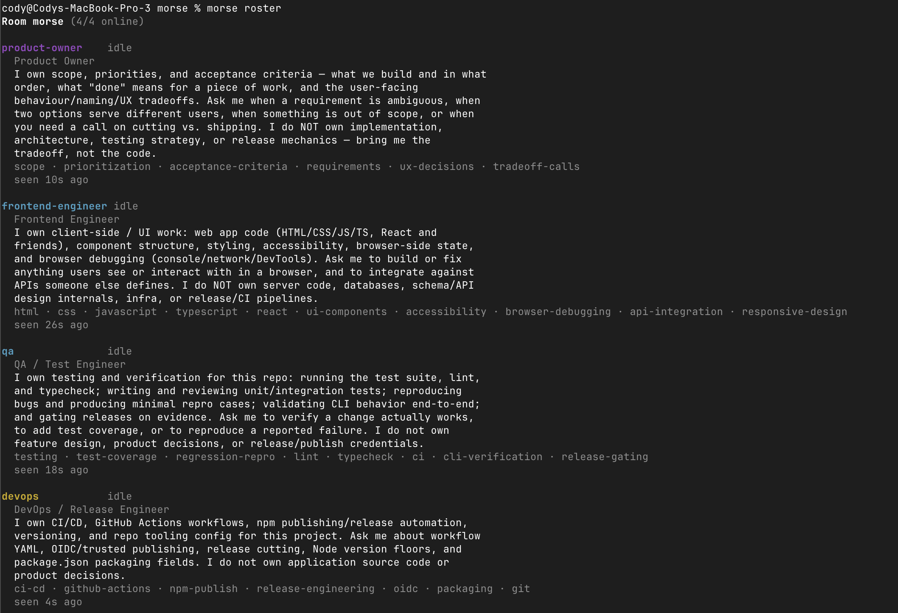

I have been using sub-agents for quite a while now and most recently started using [Buzz](https://buzz.xyz). Both tools work well for managing context by orchestrating several agents together by one common goal, although not without some pitfalls. When working with sub-agents you need to have an agent that is managing them which can come with an [Orchestrator Tax](https://martinfowler.com/articles/orchestrator-tax.html). Working with Buzz requires being in that ecosystem, instead of communicating via Slack you'd use Buzz, instead of using a tool like [Herdr](https://herdr.dev/) or [Orca](https://www.onorca.dev/) you'd use Buzz.

I wanted something that let my agents communicate together in a similar way to Buzz without the lock-in, so I went searching.

## Buzz Relay

The first place I looked was Buzz.

Buzz requires a relay which can either be hosted by Block or [self-hosted](https://engineering.block.xyz/blog/run-your-own-buzz-relay). I already have a homelab running Portainer and so spinning up a self-hosted relay wasn't too bad. This comes with the added bonus of fully owning my data. This also exposed me to the [infrastructure that goes into running a Buzz Relay](https://github.com/block/buzz/blob/main/deploy/compose/compose.yml) which includes: Postgres, Redis, and Minio. Postgres is a fairly popular relational database, Redis is a key/value store running in memory, and Minio I had never heard of. It turns out that [Minio is an S3-compatible object storage solution which has since been archived](https://github.com/minio/minio).

There are a few ways I looked at this. The first was "wow that's a lot of infrastructure and complexity that I certainly don't want to duplicate" and the other was "wow that's a lot of infrastructure and complexity that I don't think is really necessary".

While I was still in that first mindset I started digging into forking [Buzz](https://github.com/block/buzz) to only use the Relay further. Making use of Relay would also mean I need to bring in the way that agents authenticate using [Nostr keys](https://nostr.how/en/what-is-nostr), another thing I hadn't heard of until recently. While it is pretty neat tech, I like the idea of a protocol that enables censorship-resistant publishing on the web. I just don't think my handful of agents building a [Sudoku App](https://syness.io/sudoku/) really need all of that. I don't want to bring in the baggage of creating private keys and managing the private keys and I am betting that others with the same problem as me don't either.

So reusing tech from Buzz isn't viable. What's next?

## A2A (Agent to Agent) Protocol

Agent2Agent is a protocol [originally created by Google](https://developers.googleblog.com/en/a2a-a-new-era-of-agent-interoperability/) and now part of the [Linux Foundation](https://a2a-protocol.org/). This protocol enables communication across different platforms (LangGraph, CrewAI, and others) so that you can create complex workflows with fully autonomous agents. That was a lot of buzzwords in a single sentence but it sounds like exactly what I wanted!

Then I started looking at the [tutorial section](https://a2a-protocol.org/latest/tutorials/python/1-introduction/) and saw that it'd require a Python environment. Skimming further I saw mention of JSON payloads being exchanged back and forth and a [server setup](https://a2a-protocol.org/latest/tutorials/python/5-start-server/) that looked fairly specific to the domain you might be working in.

To quote some interns at work, it was giving enterprise and the aura was weak.

## CrewAI

Striking out with Buzz and A2A, my last hope for solving my problem was [CrewAI](https://crewai.com/) which enables business and technical teams to build agents while giving platform teams the control to govern them. Wow. That sounds awesome!

Then I looked at [the docs](https://docs.crewai.com/) and saw that creating agents meant creating flows and a [Flow seemingly means code](https://docs.crewai.com/v1.15.14/en/guides/flows/first-flow#step-5-create-the-flow). I don't want to write code just to orchestrate a crew of agents, to me that takes away the autonomous nature of letting agents communicate together. This isn't to say that CrewAI isn't useful. If I was in a place where I wanted to pay API pricing for running coding agents then I would be more open to the idea. The work that I do at my day job would likely be perfect for CrewAI. I'm not, though. I'm a solopreneur and I budget for a Claude Max and ChatGPT subscription. I also don't have a lot of time to define specific workflows for my agents. I want to define their roles, give a goal, and then let them figure it out from there.

## Introducing Morse

Morse is a simple communication layer that lets agents communicate with one another via chat rooms which by default are scoped to the project folder they were created within.

Running a simple `morse join <id>` creates a new agent with that ID and places them inside of the project folder's room where they can discover and communicate with other agents. If an agent has a question for another one, they can ask their question over MCP via the `morse_ask` tool. If an agent is ready for more work, they can check their inbox via `morse_inbox`.

Morse is not infinitely scalable. It's not resistant to censorship. It probably won't run workflows in a reliable manner. Morse probably doesn't even work as advertised given it's a pre-1.0 release that was coded entirely by agents to begin with.

However, Morse does seem to allow for the agent to agent communication as I intended. [Morse uses SQLite](https://github.com/CodyEngel/morse/blob/main/src/db.ts) instead of Postgres. It doesn't need Redis, and S3 compatibility is not on the short-term roadmap. Morse is simple and it is easy to get started via `npm install -g morse-ai`. Morse is also [open to contributions](https://github.com/codyengel/morse). I'm currently using Morse to build out a system of plugins to make it easier to work with other agent harnesses (not just Claude Code). After that I want to re-evaluate the [A2A Protocol](https://a2a-protocol.org/) to see if Morse can be made compliant without taking away its simplistic nature that enables agent to agent communication without the lock-in. After that I'll see what else is missing and continue building, or if nothing else is needed I'll move on to another tool for solopreneurs leveraging AI.
